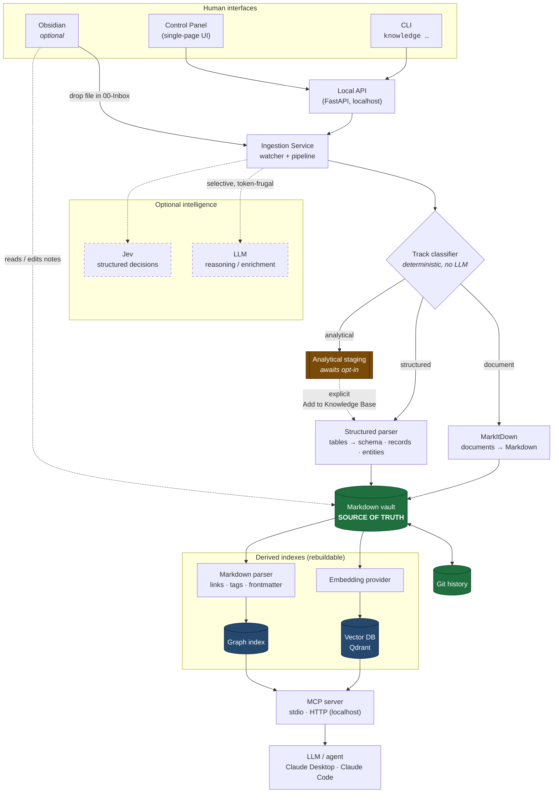
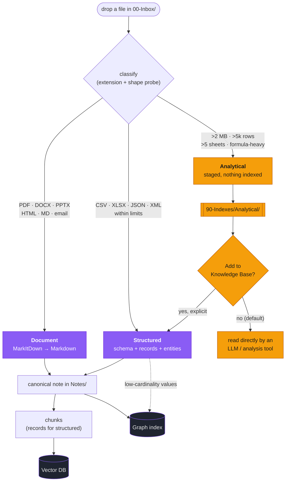
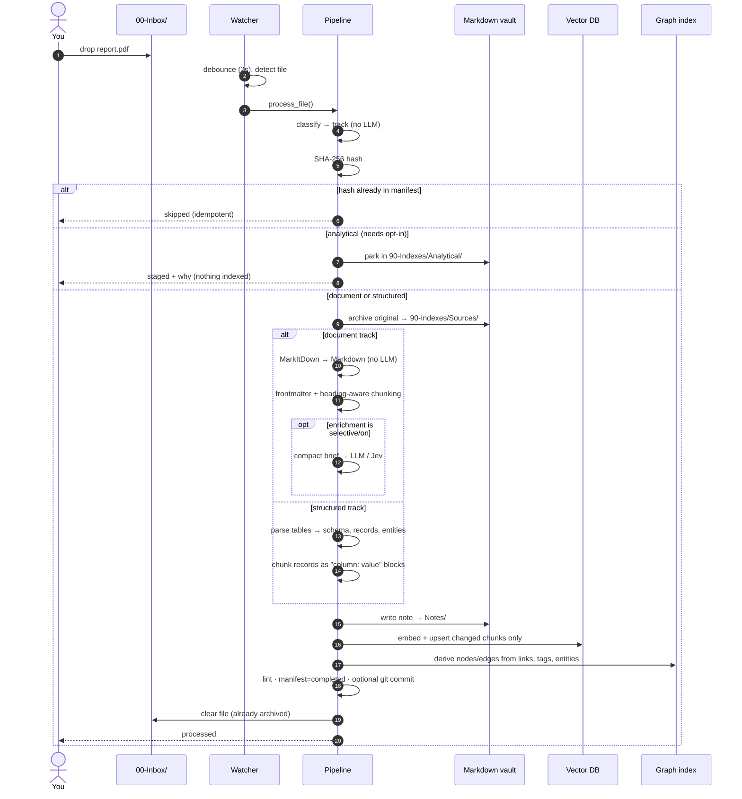
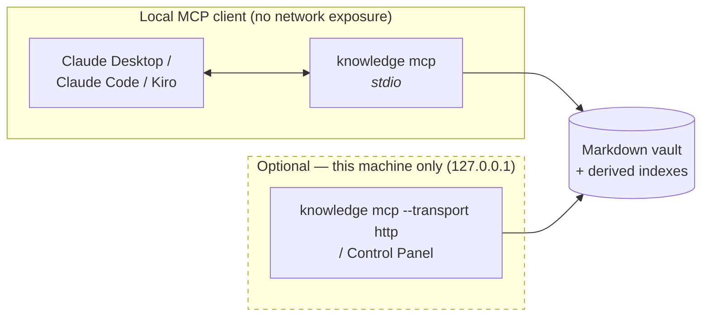

# Knowledge System

A **local-first** personal knowledge management and AI knowledge-graph system.
Drop almost any document into an inbox and walk away: it is converted to
Markdown, organised, embedded, linked into a knowledge graph, and made
searchable by both humans (Obsidian / CLI) and agents (MCP).

## Design invariants

| Layer | Role |
|-------|------|
| **Markdown + Git** | the **source of truth** |
| Obsidian | an optional UI (never a hard dependency) |
| Vector DB | a **derived** search index (rebuildable) |
| Graph index | **derived** from Markdown links / properties |
| LLM | optional reasoning / enrichment component |
| Jev | optional structured decision / classification component |

Everything derived can be rebuilt from the Markdown repository:

```
knowledge rebuild-vector-index   # re-embed from Markdown
knowledge rebuild-graph          # re-derive the graph from links
```

## Architecture



Note that analytical staging sits *outside* the derived-index box on purpose: a
staged file is neither knowledge nor an index, just a file parked for analysis.

Every external component sits behind an interface and is selected by
configuration, so Obsidian, the vector DB, the embedding model, the LLM and
Jev can each be swapped **without touching the knowledge repository**:

| Interface | Default | Alternatives |
|-----------|---------|--------------|
| `DocumentConverter` | MarkItDown (falls back to a builtin text/HTML/CSV converter) | any converter |
| `TrackClassifier` | extension + bounded shape probe (no LLM) | thresholds are configurable; can be disabled entirely |
| `StructuredParser` | CSV/TSV/XLSX/JSON/XML → schema, records, entities | any parser producing a `StructuredDoc` |
| `EmbeddingProvider` | hash (dependency-free) | `sentence_transformers`, OpenAI-compatible |
| `VectorStore` | in-memory | Qdrant (embedded on disk, or a server) |
| `GraphStore` | SQLite | in-memory, (Neo4j later) |
| `LLMProvider` | null (no tokens) | any OpenAI-compatible endpoint (Ollama/vLLM/LM Studio/OpenAI) |
| `JevProvider` | stub (isolated) | real Jev adapter when the SDK is available |

## End-to-end flow

### Ingestion: three tracks, one drop folder

Not everything you upload is knowledge. Uploads are classified **before** any
work happens, and each track gets the treatment it deserves:

| Track | Inputs | Treatment | Auto-indexed? |
|-------|--------|-----------|---------------|
| **Document** | PDF, DOCX, PPTX, HTML, MD, emails, images | MarkItDown → Markdown → chunks → embeddings → graph | yes |
| **Structured** | CSV, TSV, XLSX, JSON, XML | schema + records + entities → graph & vectors | yes |
| **Analytical** | Excel models, large datasets | staged for analysis, untouched | **no** — opt-in only |

Classification is deterministic — extension plus a cheap probe of the file's
shape (size, rows, sheets, formula density). No LLM, and every verdict comes
with reasons the UI shows you.



Every step before the optional LLM is deterministic. Content hashes make the
whole pipeline idempotent and let re-runs skip unchanged work.



#### Why analytical files are gated

A 30-sheet financial model is working material, not reference knowledge.
Indexing it would scatter thousands of meaningless number-cells through the
vector store and bury real answers. So those files are parked where an LLM or
analysis tool can read them as-is, and they enter the index only when you ask:

```bash
knowledge classify Q3-model.xlsx   # preview the decision + reasons
knowledge staged                   # what's awaiting a decision
knowledge promote Q3-model.xlsx    # "Add to Knowledge Base"
```

Thresholds and the opt-in itself are configurable — see
[docs/INGESTION.md](docs/INGESTION.md).

#### Why structured data is not just a Markdown table

A converted spreadsheet embeds badly: chunk boundaries split headers away from
rows, and a naked row like `api,Platform,eu-west-1` says nothing about what
those values mean. The structured track keeps a schema summary and row sample
for humans, and embeds `owner: Platform` / `region: eu-west-1` for the
retriever. Low-cardinality column values also become real `entity` nodes in the
graph, so they're navigable rather than dangling links.

Indexing is capped at `structured.max_rows_indexed` (2,000) rows per table, but
every row is counted. A capped table says so in the note, in its frontmatter
(`record_count`, `records_indexed`, `truncated_tables`) and in the schema chunk
the search returns ("Partial index: only the first 2000 of 50000 rows are
searchable"), so an agent doesn't mistake a sample for the whole table.

### Serving: who can reach the knowledge base



Everything runs on your machine — there is no cloud component. Stdio is the
default: the MCP client starts the server itself and nothing listens on the
network. The optional MCP HTTP server and the Control Panel bind `127.0.0.1`
only. See [docs/MCP.md](docs/MCP.md).

## Quick start

Clone the repo, then two commands: one to install, one to open the upload UI.
Everything installs for the current user only; no admin rights, nothing else
to install first (not even Python).

| | Windows | macOS |
|---|---|---|
| **Install** (once) | `install.cmd` (or double-click it) | `bash install.sh` |
| **Start the UI** | `start.cmd` | `bash start.sh` |

`start` opens the Control Panel at <http://127.0.0.1:8000>: drag files in to
upload them, search, and run the inbox watcher. Stop it with Ctrl+C.

The installer sets up:

| Component | Where | Notes |
|---|---|---|
| uv + Python 3.12 | `.tools/` in the repo | Nothing global; uses no system Python |
| All Python dependencies | `.venv/` | MarkItDown, spreadsheets, sentence-transformers, embedded Qdrant, Control Panel, MCP, dev tools |
| Embedding model | Hugging Face cache | ~90 MB, downloaded once; later starts are offline |
| Vector DB | `knowledge-vault/.knowledge/` | Embedded Qdrant, no server |
| Obsidian (optional UI) | per-user app | Skip with `-NoObsidian` / `--no-obsidian` |
| Ollama + `llama3.2:3b` (optional LLM) | per-user app | ~3.5 GB total; turns on enrichment in `.env`. Skip with `-NoLlm` / `--no-llm`, or pick a model with `-LlmModel` / `LLM_MODEL=` |

It also creates `.env` (from `.env.example`, if missing) and the vault in
`knowledge-vault/`, then runs `knowledge health` to check everything loads.
Downloads are verified (checksums, and code signatures for the apps). Re-running
is safe: finished steps are skipped and dependencies are brought up to date.

> **Cloning to another machine?** See [docs/SETUP.md](docs/SETUP.md). In short:
> this repo holds the **code**; your **vault is a separate git repo** (it's your
> data), and is git-ignored here. `knowledge init` recreates the vault anywhere.

The CLI is in `.venv` (`.\.venv\Scripts\knowledge.exe` on Windows,
`.venv/bin/knowledge` on macOS); activate the venv to use plain `knowledge`.

> **Cloning to another machine?** See [docs/SETUP.md](docs/SETUP.md). In short:
> this repo holds the **code**; your **vault is a separate git repo** (it's your
> data), and is git-ignored here. `knowledge init` recreates the vault anywhere.

Drop a file and process it:

```bash
copy report.pdf knowledge-vault\00-Inbox\
knowledge ingest-inbox           # one-shot; shows the track for each file
# or run the watcher and walk away:
knowledge watch
```

Work with the tracks:

```bash
knowledge classify vendors.xlsx  # which track, and why (nothing is ingested)
knowledge staged                 # analytical files awaiting a decision
knowledge promote vendors.xlsx   # add a staged file to the knowledge base
```

Search and navigate:

```bash
knowledge search "getting started" -n 5
knowledge graph --node welcome
knowledge graph --broken-links
```

## Control Panel (single-page UI)

One page for every routine task — no build step, no framework.

```bash
pip install -e ".[api]"
knowledge panel              # opens http://127.0.0.1:8000/
```

| Section | What you can do |
|---------|-----------------|
| **Overview** | live counts: notes, sources, pending inbox, staged, per-track totals, graph nodes/edges, broken links, orphans |
| **Upload** | drag-and-drop **multiple files** at once, or process whatever is already in the inbox; each result shows its track and why |
| **Needs a decision** | analytical files that were staged rather than indexed, each with an **Add to Knowledge Base** button |
| **Watcher & indexes** | start/stop the inbox watcher with a live log tail; rebuild the vector index or graph |
| **Connect an AI agent** | start/stop an optional MCP HTTP server on 127.0.0.1 (in-process, read-only by default) and copy its local URL; stdio clients need none of this |
| **Search** | semantic search with scores and heading paths |
| **Notes** | everything currently in the vault |
| **CLI equivalents** | copy-paste commands for every action, including the Claude Code registration line |

The panel is a thin client over the same services the CLI and MCP server use,
so nothing behaves differently depending on how you drive it.

> **Security:** the panel binds to `127.0.0.1` and has **no authentication**. It
> can start local processes, so never expose it to a network or bind it to
> `0.0.0.0`.

## Search backends

The installer configures real semantic search in `.env`: a local
sentence-transformers model and embedded Qdrant (on disk under
`.knowledge/state/qdrant`, no server to run):

```ini
# .env
KS_EMBEDDING__PROVIDER=sentence_transformers
KS_VECTOR__PROVIDER=qdrant_local
```

Without a `.env`, the built-in defaults are `hash` embeddings and an in-memory
index. They need no extras, but `hash` only matches shared words, not meaning.
A configured provider whose extra is missing is an error, not a silent
fallback. The index records which embedding setup built it; after changing
model, provider or dim, run `knowledge rebuild-vector-index` (search and ingest
refuse to mix vectors until you do).

Embedded Qdrant allows one process at a time. If you need the watcher and an
MCP client on the index at the same time, run a Qdrant server yourself and set
`KS_VECTOR__PROVIDER=qdrant` + `KS_VECTOR__URL=http://localhost:6333`.

Then re-embed from the Markdown source of truth:

```bash
knowledge rebuild-vector-index
```

### Optional: a local LLM for enrichment

Enrichment adds a summary, a topic, entities and suggested links to each note.
It's useful but never required, and it's the only part of the pipeline that
isn't deterministic. The installer sets it up with [Ollama](https://ollama.com)
and `llama3.2:3b` (skip with `-NoLlm` / `--no-llm`). Without it, `llm.provider`
stays `null`: no model, no tokens.

`openai` names the **wire protocol, not the vendor**, so any OpenAI-compatible
server works. The installer writes these settings; to set them by hand:

```ini
# .env
KS_LLM__PROVIDER=openai
KS_LLM__BASE_URL=http://localhost:11434/v1
KS_LLM__MODEL=llama3.2:3b
KS_LLM__ENRICHMENT_MODE=selective
```

```bash
knowledge health               # confirms llm_available + the model in use
```

LM Studio (`http://localhost:1234/v1`), vLLM and OpenAI itself work the same
way — only `base_url`, `model` and `api_key` change. Nothing leaves your machine
unless you point `base_url` at a hosted endpoint.

Practical notes for CPU-only inference:

- Pick a small instruct model. A 3B answers the enrichment prompt in tens of seconds on a laptop CPU; a 7B+ is painful without a GPU.
- Prefer models that **don't** emit `<think>` scratchpads. Reasoning traces are stripped before JSON parsing, but they burn the token budget for no benefit here.
- `llm.keep_alive` (default `30m`) stops the server evicting the model between notes, which otherwise makes every file pay the load cost again.
- If the endpoint is down, `knowledge health` reports `llm_available: false` and ingestion carries on without enrichment rather than failing per file.

## MCP server

```bash
pip install -e ".[mcp]"
knowledge mcp               # stdio transport (default)
```

To connect a local MCP client (Claude Desktop, Kiro, …), see
[Connect a local MCP client (stdio)](docs/MCP.md#connect-a-local-mcp-client-stdio).

Read-only by default: `search_knowledge`, `get_note`, `list_tags`,
`list_topics`, `graph_neighbors`, `graph_orphans`, `graph_broken_links`,
`health`, plus a `knowledge://note/{path}` resource. The tools that change the
vault (`ingest_file`, `create_note`, `rebuild_vector_index`) are only offered
with `knowledge mcp --allow-writes`, so instructions hidden in an ingested
document can't get the agent to modify your notes. See
[docs/MCP.md](docs/MCP.md).

## Obsidian (optional UI)

Open `knowledge-vault/` with Obsidian via *Open folder as vault* (or the URI
`obsidian://open?path=<vault-path>`). Wiki links (`[[Note]]`), tags and
frontmatter all work natively.

`knowledge init` writes sensible Obsidian defaults into `.obsidian/` so the
vault opens ready to use:

- Core plugins on: graph, backlinks, outgoing links, tag pane, properties,
  outline, templates, quick switcher, global search, bookmarks.
- New notes and ingested notes land in `Notes/`; the templates folder is
  wired to `90-Indexes/Templates`.
- A `Notes/Home.md` Map-of-Content explains the metadata-driven workflow.

Per-user files (`.obsidian/workspace*`, cache) are git-ignored. Obsidian is
**not** required — remove it and everything still works.

### Upload documents from Obsidian

Obsidian's attachment folder is pointed at `00-Inbox/`, so you can use it as a
one-stop upload UI. With the watcher running (`knowledge watch`):

- **Drop a file onto the `00-Inbox` folder** in the file explorer sidebar
  (cleanest), **or** drag/paste a file into a note (Obsidian copies it to
  `00-Inbox/`).
- The watcher converts it to a note in `Notes/`, archives the original in
  `90-Indexes/Sources/`, and clears it from the inbox (a single archived copy,
  never duplicated).

Note: if you drag a file *into a note*, Obsidian inserts an `![[file]]` embed.
The original is preserved (in `Sources/`), so the embed still resolves by
name — but the primary result is the generated note in `Notes/`, which is what
you'll link to and search. A *different* file with an already-used name is
archived as `<name>-<hash8>.<ext>` instead of overwriting the earlier original.

### Editing generated notes

Generated notes are yours to edit, with one rule: re-ingesting a source
regenerates its note, so edits to the generated text are replaced by the new
version of the source. What you add is kept:

- a `## My notes` section (up to the next `##` heading) — moved to the end of
  the regenerated note and indexed for search;
- your frontmatter: `domain`, `topic`, `status` keep your value, `tags` /
  `related` / `aliases` are merged, and any key you add yourself is left alone.

A source keeps the same note when it's re-ingested, even if its title changes.
New notes are named after the source file, not its title, so two documents
called "Meeting Notes" get two notes.

### Organization: flat + metadata-driven

There is **no fixed folder taxonomy**. All notes live in one content folder
(`Notes/` by default). Structure comes from note metadata, not directories:

- `domain` / `topic` in frontmatter
- `tags` (browse via Obsidian's tag pane)
- `[[wiki links]]` and `related:` (browse via the graph)

Folders are just storage; move or rename notes freely. Search never returns a
note whose file is gone, and `knowledge rebuild-vector-index --incremental`
re-points moved notes and drops deleted ones. Domains/topics are emergent from
what you actually write — the taxonomy grows with your content instead of being
predefined.

## Documentation

- [docs/SETUP.md](docs/SETUP.md) — fresh-clone setup, dependencies, repo model
- [docs/ARCHITECTURE.md](docs/ARCHITECTURE.md) — components and data flow
- [docs/INGESTION.md](docs/INGESTION.md) — the pipeline, idempotency, checkpoints
- [docs/CONFIGURATION.md](docs/CONFIGURATION.md) — every setting
- [docs/MCP.md](docs/MCP.md) — MCP tools, local client (stdio) setup
- [docs/JEV.md](docs/JEV.md) — where the real Jev integration goes

## Testing

```bash
pytest            # default providers only; no Qdrant/LLM/network needed
ruff check src tests
```

## License

MIT
